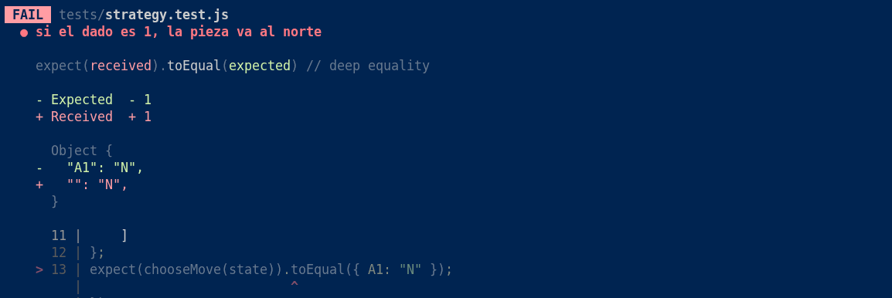
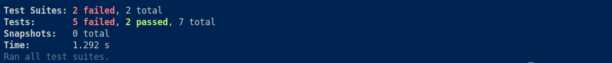
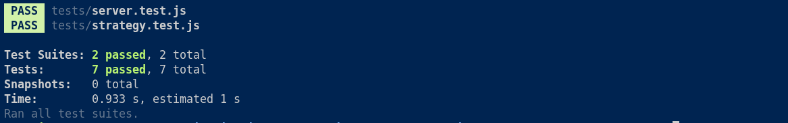

# Evidencia TP6 - Pruebas de regresión

## 1. Problema observado

Durante el torneo, el bot de un compañero no realizaba movimientos. Como consecuencia, recibió dos tarjetas amarillas, una roja y quedó descalificado.

No pude determinar la causa exacta del problema porque no cuento con el código ni con los registros de ese bot.

## 2. Reproducción del fallo

Para reproducir un problema similar en mi proyecto, agregué una prueba para comprobar que el bot devuelva correctamente los movimientos de las piezas del jugador.

Luego modifiqué temporalmente la condición que identifica las piezas propias en `src/strategy.js`.

Al ejecutar `npm test`, las pruebas fallaron porque la estrategia devolvía un movimiento con el identificador vacío (`""`) en lugar de identificar correctamente las piezas.

**Captura 1: error de la prueba roja.**



**Captura 2: resumen de las pruebas fallidas.**



## 3. Corrección realizada

Restauré la condición correcta en `src/strategy.js`:

```js
if (celda[0] === state.jugador) {
```

De esta manera, la estrategia vuelve a identificar las piezas correspondientes al jugador y genera sus movimientos correctamente.

## 4. Prueba exitosa

Después de realizar la corrección, ejecuté nuevamente `npm test`.

El resultado fue:
- Suites de pruebas: 2 pasaron de 2.
- Pruebas: 7 pasaron de 7.
- Pruebas fallidas: 0.

**Captura 3: resultado de las pruebas después de la corrección.**



## 5. Conclusión

Con