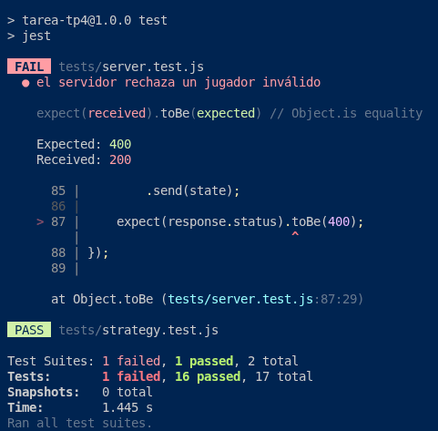
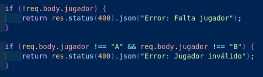
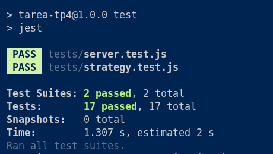

# Bot Express TP4

Trabajo Práctico Nº 4 - Diseños y Arquitecturas de Despliegues 1

## Descripción

Este proyecto consiste en un bot desarrollado con Node.js y Express.

El bot recibe un estado del juego en formato JSON mediante `POST /move` y devuelve los movimientos que debe realizar cada ficha del jugador.

La estrategia del bot es determinista y se basa en el número obtenido en el dado.

## Tecnologías utilizadas

* Node.js
* Express
* Nodemon

## Estructura del proyecto

```text
tarea-tp4/
├── fixtures/
│   ├── state1.json
│   └── state2.json
├── src/
│   ├── handler.js
│   ├── server.js
│   └── strategy.js
├── .gitignore
├── package.json
└── package-lock.json
```

## Funcionamiento

El proyecto está separado en tres partes:

### `src/server.js`

Se encarga de iniciar el servidor Express, configurar `express.json()` y definir las rutas `POST /move` y `GET /health`.

También utiliza la variable de entorno `PORT` para configurar el puerto. Si no se indica, utiliza el puerto `3000`.

Además, contiene la validación de los datos recibidos y el manejo de respuestas `404` y `500`.

### `src/handler.js`

`moveHandler` recibe el estado enviado en la petición mediante `req.body`.

Luego llama a la función `chooseMove(state)` de `strategy.js` y devuelve el resultado en formato JSON.

También contiene `healthHandler`, que responde al endpoint `/health` indicando que el servidor está funcionando correctamente.

### `src/strategy.js`

Contiene la estrategia del bot.

La estrategia recorre el tablero y busca las fichas que pertenecen al jugador indicado en el estado.

Una vez encontrada una ficha, se utiliza el valor del dado para decidir hacia dónde se mueve.

Las reglas utilizadas son:

| Valor del dado | Dirección   |
| -------------- | ----------- |
| `1`            | Norte (`N`) |
| `2`            | Este (`E`)  |
| `3`            | Sur (`S`)   |

Por ejemplo, si el jugador tiene una ficha `A1` y el dado es `3`, el resultado será:

```json
{
  "A1": "S"
}
```

Si el jugador tiene dos fichas `B1` y `B2` y el dado es `2`, el resultado será:

```json
{
  "B1": "E",
  "B2": "E"
}
```

## Fixtures

La carpeta `fixtures/` contiene estados de prueba en formato JSON.

### `state1.json`

Tiene como jugador a `A` y el dado tiene valor `3`.

La respuesta esperada es:

```json
{
  "A1": "S"
}
```

### `state2.json`

Tiene como jugador a `B` y el dado tiene valor `2`.

La respuesta esperada es:

```json
{
  "B1": "E",
  "B2": "E"
}
```

## Instalación

Para instalar las dependencias del proyecto:

```bash
npm install
```

## Ejecución

Para iniciar el servidor normalmente:

```bash
npm start
```

Para ejecutar el servidor durante el desarrollo utilizando Nodemon:

```bash
npm run dev
```

El servidor utiliza el puerto `3000` por defecto.

También se puede configurar otro puerto utilizando `PORT`.

Ejemplo:

```bash
PORT=4000 npm start
```

## Pruebas

Para probar el primer fixture:

```bash
curl -X POST http://localhost:3000/move -H "Content-Type: application/json" -d @fixtures/state1.json
```

Resultado esperado:

```json
{
  "A1": "S"
}
```

Para probar el segundo fixture:

```bash
curl -X POST http://localhost:3000/move -H "Content-Type: application/json" -d @fixtures/state2.json
```

Resultado esperado:

```json
{
  "B1": "E",
  "B2": "E"
}
```

## Pruebas TP5

### 1. GET `/health`

Comando:

```bash
curl -i http://localhost:3000/health
```

Resultado esperado:

```text
HTTP/1.1 200 OK
```

Respuesta:

```json
{
  "status": "ok"
}
```

### 2. POST `/move` válido

Comando:

```bash
curl -X POST http://localhost:3000/move -H "Content-Type: application/json" -d @fixtures/state1.json
```

Resultado esperado:

```text
HTTP/1.1 200 OK
```

Respuesta:

```json
{
  "A1": "S"
}
```

### 3. POST `/move` con datos incompletos

En este caso se envía un estado sin `jugador`.

Comando:

```bash
curl -i -X POST http://localhost:3000/move -H "Content-Type: application/json" -d '{"dado":3,"tablero":[]}'
```

Resultado esperado:

```text
HTTP/1.1 400 Bad Request
```

Respuesta:

```text
"Error: Falta jugador"
```

### 4. Ruta inexistente

Comando:

```bash
curl -i http://localhost:3000/una-ruta-que-no-existe
```

Resultado esperado:

```text
HTTP/1.1 404 Not Found
```

Respuesta:

```text
"Error 404"
```

### 5. Error interno

Se probó el manejo de errores internos durante el desarrollo del TP.

Resultado esperado:

```text
HTTP/1.1 500 Internal Server Error
```

Respuesta:

```text
"Error 500"
```

Además, el error se registra en la consola del servidor mediante `console.error()`.

## Scripts disponibles

| Comando       | Función                        |
| ------------- | ------------------------------ |
| `npm install` | Instala las dependencias       |
| `npm start`   | Inicia el servidor             |
| `npm run dev` | Inicia el servidor con Nodemon |

## Git

El proyecto utiliza Git para registrar los cambios de forma incremental.

El repositorio contiene commits correspondientes a las distintas etapas del desarrollo del bot.


## Evidencias TP7

En este trabajo se agregaron pruebas automatizadas con Jest para comprobar el funcionamiento del bot y detectar posibles problemas.

### Pruebas realizadas

Se agregaron pruebas para verificar:

- Que los movimientos correspondan al valor del dado.
- Que el bot pueda mover varias piezas del mismo jugador.
- Que no mueva las piezas del rival.
- Que no mueva las casas neutrales.
- Que funcione correctamente con los jugadores A y B.
- Que no devuelva movimientos cuando el jugador no tiene piezas.
- Que la estrategia no modifique el estado original.
- Que funcione con semillas fijas (12345 y 54321).
- Que el servidor rechace solicitudes sin jugador.
- Que el servidor rechace jugadores inválidos.
- Que funcionen correctamente los endpoints y la integración entre el servidor y la estrategia.

### Mejora realizada

Se agregó una prueba para comprobar qué sucedía cuando se enviaba un jugador inválido.

En la primera ejecución, la prueba falló porque el servidor aceptaba al jugador `"C"` y devolvía un código 200, cuando debía rechazarlo con un código 400.

Para solucionarlo, se modificó la validación del servidor. Ahora solamente acepta los jugadores `"A"` y `"B"`. También diferencia entre cuando falta el jugador y cuando se envía un valor inválido.

### Resultado final

Después de realizar la corrección, se volvió a ejecutar `npm test`.

- 2 suites de pruebas aprobadas.
- 17 pruebas aprobadas.
- 0 pruebas fallidas.

### Capturas de evidencia

**1. Prueba roja:**



**2. Corrección de la validación:**



**3. Prueba verde:**



